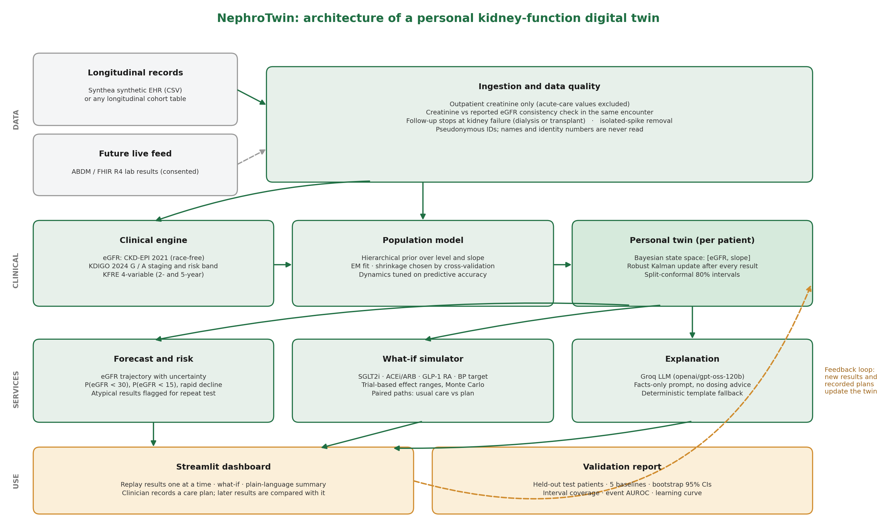
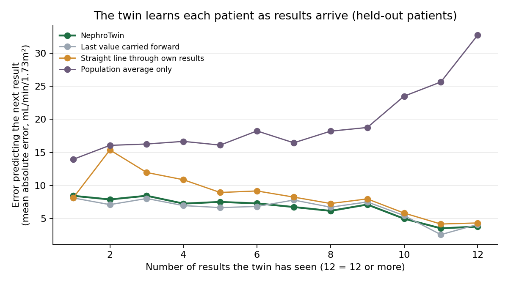
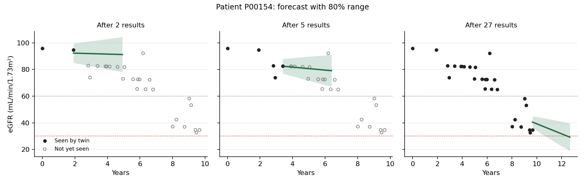

# NephroTwin: a personal digital twin for chronic kidney disease

NephroTwin keeps a living statistical model of one person's kidney function. Every new creatinine result updates the twin's belief about the person's current eGFR and how fast it is changing. From that belief it forecasts future kidney function with an honest uncertainty range, estimates the chance of crossing clinical thresholds, simulates care plans, and explains the result in plain language for the patient and the clinician.

**Live app:** [Add your Streamlit app link]
**Demo video:** [Add your unlisted YouTube link]



---

## Team details

| Name | Role | Email |
|---|---|---|
| [Your name] | [Role] | [Email] |

## College / Incubator information

[Institute name, programme, city]

## Project title

**NephroTwin: a personal kidney-function digital twin for early detection and management of chronic kidney disease progression**

## Problem statement

Chronic kidney disease (CKD) is silent. Most people lose kidney function for years without symptoms, and the decline is often noticed only when it is advanced. India's burden is driven by diabetes and hypertension: the ICMR-INDIAB-17 study estimated 101 million people with diabetes, 136 million with prediabetes and about 315 million with hypertension (Anjana et al., *Lancet Diabetes & Endocrinology*, 2023), and both conditions are leading causes of CKD.

Kidney function is usually judged from one result at a time. A single eGFR value is noisy, so a real decline is easy to miss and a one-off bad result is easy to over-react to. What clinicians need is the *trajectory*: where this person's kidney function is heading, how sure we are, and what would change it.

## Healthcare use case

**Who uses it:** a primary-care doctor, physician or nephrologist reviewing a patient with diabetes, hypertension or early CKD.

**What it does at each review:**
1. Reads every past creatinine result and converts it to eGFR (CKD-EPI 2021).
2. Updates the patient's twin and shows the current eGFR, KDIGO stage and personal rate of change, each with an uncertainty range.
3. Forecasts the next one to ten years and gives the probability of eGFR falling below 30 or 15.
4. Flags a single result that is unexpectedly far from the trend, so it can be repeated before anyone acts on it.
5. Simulates care plans (SGLT2 inhibitor, ACE inhibitor or ARB optimisation, GLP-1 receptor agonist, blood-pressure control) using effect ranges from published trials.
6. Writes a short plain-language summary for the patient and a structured note for the clinician.
7. Records the chosen plan; later results are compared against what the plan predicted, closing the loop between the twin and the patient.

## What makes it a digital twin rather than a risk score

| Property | How NephroTwin shows it |
|---|---|
| Personal | Each patient has their own state (current eGFR and slope), starting from a population prior and moving toward their own data. |
| Continuously updated | An exact Bayesian (Kalman) update runs after every new result. The dashboard replays history one result at a time. |
| Predictive | Forecasts eGFR and the probability of crossing eGFR 30 and 15. |
| Simulatable | What-if scenarios change the personal slope and propagate uncertainty by Monte Carlo. |
| Honest about uncertainty | 80% intervals calibrated by split-conformal prediction and checked on held-out patients. |
| Two-way | Recorded care plans are carried forward and compared with later results. |

## Technical stack

| Layer | Tools |
|---|---|
| Language | Python 3.12 |
| Data and maths | pandas, NumPy, SciPy, scikit-learn |
| Synthetic data | Synthea v4.0.0 (open-source synthetic patient generator) |
| Dashboard | Streamlit, Plotly |
| Language model | Groq API (`openai/gpt-oss-120b`), with a deterministic fallback |
| Figures | Matplotlib |
| Quality | pytest (37 tests), GitHub Actions CI |
| Hosting | Streamlit Community Cloud |

## AI/ML model and framework details

**1. Clinical engine** (`nephrotwin/clinical.py`)
- eGFR from serum creatinine with the race-free CKD-EPI 2021 equation (Inker et al., *NEJM*, 2021).
- KDIGO 2024 GFR (G1 to G5) and albuminuria (A1 to A3) categories and the KDIGO risk band.
- 4-variable Kidney Failure Risk Equation (Tangri et al., *JAMA*, 2011 and 2016), using the non-North American recalibration, applied only inside its validated range (adults with eGFR below 60 and a urine ACR result).

**2. Population model** (`nephrotwin/twin.py`, `PopulationPrior`)
- Hierarchical linear mixed-effects model of starting eGFR and yearly slope, with baseline covariates (age, diabetes, hypertension, sex), fitted by Expectation-Maximisation.
- Shrinkage of covariate effects and the level-slope dependence structure are selected by 3-fold cross-validation inside the fitting cohort.

**3. Personal twin** (`nephrotwin/twin.py`, `DigitalTwin`)
- Bayesian state-space model (local linear trend). The hidden state is the patient's true eGFR and its current slope; each laboratory result is the true value plus measurement noise.
- Process noise lets the trajectory change over time. Its size is tuned to maximise out-of-sample predictive accuracy at both short and one-year horizons.
- Robust update: a result more than three standard deviations from expectation is down-weighted and flagged for repeat testing.
- Split-conformal calibration on a separate calibration cohort so the 80% interval covers about 80% of real results.

**4. What-if simulator** (`nephrotwin/interventions.py`)
- Each treatment is a triangular distribution of relative slowing of eGFR decline, taken from trial-level slope results (DAPA-CKD, EMPA-KIDNEY and DAPA advKD for SGLT2 inhibitors; RENAAL and IDNT for ARBs; FLOW for semaglutide; KDIGO guidance for blood pressure).
- Usual care and the plan are simulated on identical random draws, so the difference reflects the plan, not sampling noise.

**5. Explanation layer** (`nephrotwin/explain.py`)
- The language model receives only the numbers the twin computed and is instructed never to invent numbers, diagnose or give doses. Without an API key a fixed template produces the same two sections.

## Data

- **Source:** synthetic adults aged 40 to 85 generated with Synthea v4.0.0. No real patient data is used.
- **Data-quality rules** (`nephrotwin/ingest.py`): outpatient creatinine only; removal of creatinine that contradicts the eGFR reported in the same encounter; follow-up stops at kidney failure (dialysis or transplant); isolated single-result spikes removed; pseudonymous IDs.
- **Cohort after cleaning:** 404 patients, 4,274 laboratory results, median 10 results and 9.0 years of follow-up per patient. 21% had CKD G3 or worse at entry; 18% had diabetes and 39% hypertension.
- Full details: [docs/data_card.md](docs/data_card.md).

## Results

All numbers come from 121 held-out test patients that were never used to fit or tune the model (1,131 next-result forecasts and 6,903 forecasts one year or more ahead). Error is mean absolute error in eGFR units (mL/min/1.73m²); lower is better.

| Method | Next result | 1 year or more ahead |
|---|---|---|
| **NephroTwin** | **6.79** | **8.80** |
| Last value carried forward | 6.67 | 8.57 |
| Patient's mean so far | 7.44 | 8.84 |
| Straight line through the patient's own results | 8.93 | 22.15 |
| Population average only | 19.46 | 23.95 |

**Paired comparisons** (patient-level bootstrap, 95% confidence interval):
- Against a straight line fitted to the patient's own results, NephroTwin is clearly more accurate: 2.1 points better for the next result (CI 1.5 to 2.8) and 13.4 points better one year or more ahead (CI 7.5 to 21.8).
- Against carrying the last value forward, the difference is not statistically significant at either horizon (next result +0.12, CI −0.26 to +0.52). In a mostly stable synthetic cohort this simple baseline is hard to beat on point accuracy. Unlike it, NephroTwin also provides calibrated uncertainty, event probabilities and simulation.

**Uncertainty calibration:** 82% of real next results and 84% of results one year or more ahead fell inside the twin's 80% interval.

**Event prediction (preliminary):** for measured eGFR below 30 about two years after a landmark visit, AUROC was 0.93 for NephroTwin and 0.58 for the population model. This rests on only 5 events, so it is not a reliable estimate.




## How to run

```bash
pip install -r requirements.txt
streamlit run streamlit_app.py
```

To rebuild every artefact from scratch (data generation takes 30 to 90 minutes):

```bash
bash scripts/generate_synthea.sh 1000 42 data/raw/synthea_s42
python -m nephrotwin.pipeline --synthea data/raw/synthea_s42/csv
pytest -q
```

Or open [notebooks/NephroTwin_build.ipynb](notebooks/NephroTwin_build.ipynb) in Google Colab.

To enable the language-model summaries, add `GROQ_API_KEY` to `.streamlit/secrets.toml` (see `.streamlit/secrets.toml.example`) or to the app's secrets on Streamlit Community Cloud.

## Repository structure

```
nephrotwin/            core package (clinical, ingest, twin, interventions, evaluation, explain, summary, plots, pipeline)
streamlit_app.py       dashboard
tests/                 37 unit and integration tests
notebooks/             Colab build notebook
scripts/               Synthea generation script
data/processed/        cleaned timeline used by the app
models/                fitted population model
reports/               metrics.json and figures
docs/                  architecture diagram, presentation, model card, data card
```

## Limitations

- Synthetic data: Synthea's kidney trajectories are mostly stable, with few progression events. Results show the method works end to end; they are not evidence of clinical accuracy.
- Not yet validated on Indian patients. Indian creatinine-based eGFR and KFRE calibration would need checking on local cohorts.
- Treatment effects are trial averages and cannot predict an individual's response.
- Event-prediction results rest on very few events.

## Ethics, privacy and safety

- No real patient data is used. The pipeline never reads names, addresses or identity numbers, even when present in the source files.
- Designed for India's Digital Personal Data Protection Act 2023 principles (consent, purpose limitation, data minimisation) and for ABDM-style FHIR interoperability in any future deployment.
- Decision support only. Not a medical device and not approved for clinical use. Every screen and summary says so.

## Open-source licence

Code is released under the **MIT License** (see [LICENSE](LICENSE)). Synthea is distributed under the Apache License 2.0; the synthetic data it generates contains no real patient information.

## Architecture diagram and presentation

- Architecture diagram: [docs/architecture.pdf](docs/architecture.pdf)
- Presentation: [docs/presentation.pdf](docs/presentation.pdf)
- Model card: [docs/model_card.md](docs/model_card.md)

## Access

All files in this repository and the linked app and video are publicly accessible without sign-in or permissions.

## Key references

- Inker LA et al. New creatinine- and cystatin C-based equations to estimate GFR without race. *N Engl J Med* 2021;385:1737-49.
- KDIGO 2024 Clinical Practice Guideline for the Evaluation and Management of CKD. *Kidney Int* 2024;105(4S).
- Tangri N et al. A predictive model for progression of CKD to kidney failure. *JAMA* 2011;305:1553-59.
- Tangri N et al. Multinational assessment of accuracy of equations for predicting risk of kidney failure. *JAMA* 2016;315:164-74.
- Heerspink HJL et al. Effect of dapagliflozin on the rate of decline in kidney function (DAPA-CKD). *Lancet Diabetes Endocrinol* 2021.
- Perkovic V et al. Effects of semaglutide on CKD in type 2 diabetes (FLOW). *N Engl J Med* 2024.
- Anjana RM et al. Metabolic non-communicable disease health report of India: ICMR-INDIAB-17. *Lancet Diabetes Endocrinol* 2023;11:474-89.
- National Academies of Sciences, Engineering, and Medicine. *Foundational Research Gaps and Future Directions for Digital Twins.* 2023.
- Walonoski J et al. Synthea: an approach, method, and software mechanism for generating synthetic patients. *JAMIA* 2018;25:230-38.
